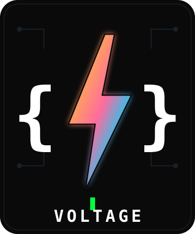
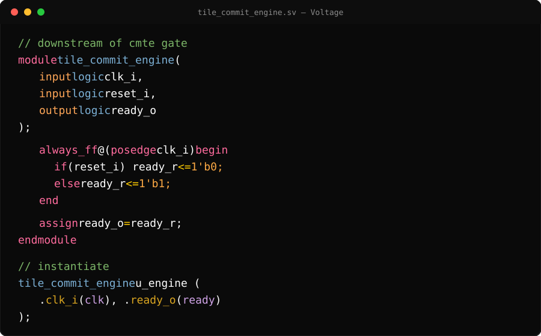
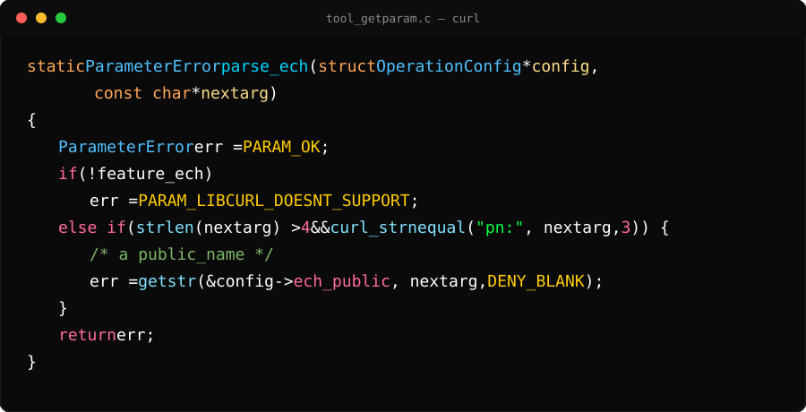
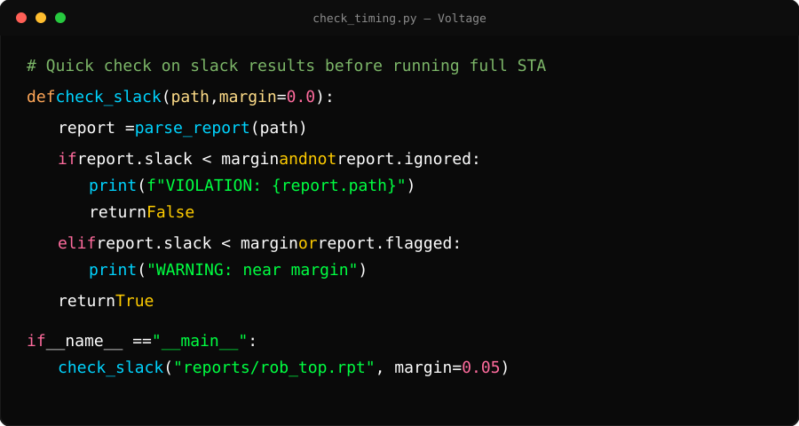
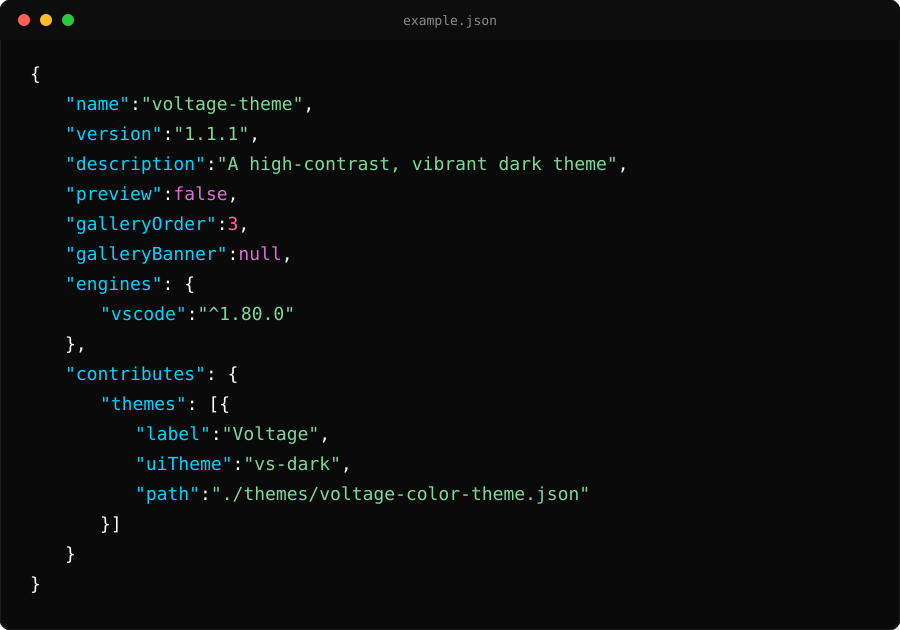

<p align="center">
  
</p>

<h1 align="center">Voltage</h1>

<p align="center">
  A high-contrast, vibrant dark theme for VS Code, Vim, Neovim and nano.
</p>

<p align="center">
  <a href="https://marketplace.visualstudio.com/items?itemName=VerdantLeaf.voltage-theme">VS Code Marketplace</a> ·
  <a href="https://github.com/VerdantLeaf/voltage-theme/releases">Releases</a> ·
  <a href="docs/palette.md">Palette</a> ·
  <a href="CONTRIBUTING.md">Contributing</a>
</p>

I never found a color theme that made code easy to read *and* looked good, so I built my own. Voltage pairs rich, vivid colors with a clean dark background, tuned for each language so you can tell at a glance what you're looking at. No dimming, no washed-out colors.

## Preview

**SystemVerilog**

<p align="center">
  
</p>

**C** (excerpt from [curl](https://github.com/curl/curl))

<p align="center">
  
</p>

**Python** (excerpt from [omlx](https://github.com/jundot/omlx))

<p align="center">
  
</p>

**JSON**

<p align="center">
  
</p>

## Install

| Tool | Quickest way |
|---|---|
| [VS Code](#vs-code) | `code --install-extension VerdantLeaf.voltage-theme` |
| [Vim, Neovim and nano](#vim-neovim-and-nano) | `curl -fsSL https://raw.githubusercontent.com/VerdantLeaf/voltage-theme/main/bash/update-voltage.sh \| bash` |

For the exact look in a terminal, set its background to `#0d1117`.

### VS Code

Install **Voltage Theme** from the [Marketplace](https://marketplace.visualstudio.com/items?itemName=VerdantLeaf.voltage-theme), then press `Ctrl+Shift+P` → **Preferences: Color Theme** → **Voltage**.

To install offline, download the `.vsix` from [Releases](https://github.com/VerdantLeaf/voltage-theme/releases) and run:

```bash
code --install-extension voltage-theme-<version>.vsix
```

The extension also adds syntax highlighting for nano config files (`.nanorc`).

#### Recommended settings

Voltage colors bracket pairs, but the guide lines connecting them are an editor setting you have to turn on in `settings.json`:

```json
{
  "editor.guides.bracketPairs": true
}
```

Voltage doesn't include file icons. If you use [Material Icon Theme](https://marketplace.visualstudio.com/items?itemName=PKief.material-icon-theme), these tints pair well:

```json
{
  "workbench.iconTheme": "material-icon-theme",
  "material-icon-theme.folders.color": "#F56600",
  "material-icon-theme.files.color": "#522DB0"
}
```

### Vim, Neovim and nano

The command in the table above downloads the latest nano and Vim/Neovim releases and runs their installers, skipping any editor you don't have. Re-run it to update.

You can also install from a clone, or from a `voltage-vim-*` / `voltage-nano-*` tarball on the [Releases](https://github.com/VerdantLeaf/voltage-theme/releases) page:

```bash
./vim/install.sh     # --vim or --nvim to pick one
./nano/install.sh
```

Each installer adds a marked block to your config and leaves the rest alone. Run it with `--uninstall` to remove Voltage.

**Vim and Neovim**

- Colors match VS Code exactly in a **24-bit color terminal** (inside tmux, enable `Tc`/`RGB`). Otherwise they fall back to the nearest 256-color values.
- Neovim with Treesitter/LSP colors declarations, calls, parameters and members separately. Plain Vim's regex syntax can't tell parameters or declarations apart.
- Files are installed to `~/.vim/colors/` and `~/.config/nvim/colors/`.

**nano**

- Covers C/C++/CUDA, Python, SystemVerilog, Tcl/SDC, JSON, YAML, TOML, Markdown and shell.
- Colors are mapped to the nearest 256-color values. nano older than 6.0 (e.g. on RHEL 9) only gets named colors; after upgrading, re-run the installer.
- Highlighting is regex-based, so semantic distinctions such as parameters vs. locals aren't available.
- Files are installed to `~/.config/nano/voltage/`.

## Bonus: my Bash and tmux configs

This repo also holds my personal [`.bashrc`](bash/.bashrc), so I can set up a new server in moments. It's shared as-is: **read it before installing**, since it changes the behavior of commands such as `less`, `du` and `nano`.

It includes a prompt showing the git branch, prefix-based history search, aliases for git, ripgrep and fd, and helpers such as `mkcd` and `lz` (directory sizes).

```bash
curl -fsSL https://raw.githubusercontent.com/VerdantLeaf/voltage-theme/main/bash/update-bash.sh | bash
source ~/.bashrc
```

The config is saved to `~/.bashrc.verdantleaf` and sourced from your `~/.bashrc`, so your existing settings file isn't replaced.

| Command | What it does |
|---|---|
| `update-bash` | Overwrites `~/.bashrc.verdantleaf` with the latest version from `main` |
| `update-voltage` | Installs the latest nano and Vim/Neovim themes |
| `update-tmux` | Installs or updates the tmux config below |

Nothing is fetched automatically when a shell starts. To uninstall, delete `~/.bashrc.verdantleaf` and the `source` line in `~/.bashrc`.

### tmux

[The tmux config](tmux/.tmux.conf) provides:

- Mouse mode, scrolling one line per wheel step instead of five
- Windows and panes numbered from 1
- A Voltage status bar with window names taken from the running program or current folder
- A session badge that turns gold after `Ctrl+b`, orchid in copy mode and red when panes are synchronized

```bash
curl -fsSL https://raw.githubusercontent.com/VerdantLeaf/voltage-theme/main/tmux/update-tmux.sh | bash
```

It's saved to `~/.tmux.verdantleaf.conf` and sourced from your `~/.tmux.conf`, so your existing settings file isn't replaced. New tmux servers load it automatically; in a running one, use `tmux source-file ~/.tmux.verdantleaf.conf`. Update with the same command, or `update-tmux` if you use the Bash config. To uninstall, delete the file and the `source-file` line, then restart tmux.

## License

[MIT](LICENSE). This is a living theme: colors get adjusted as new languages and edge cases come up.
