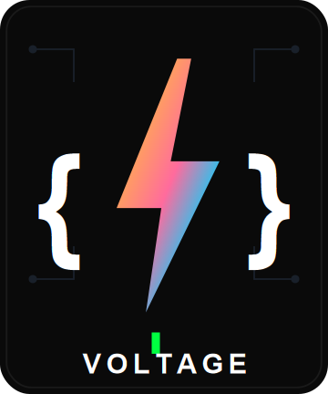
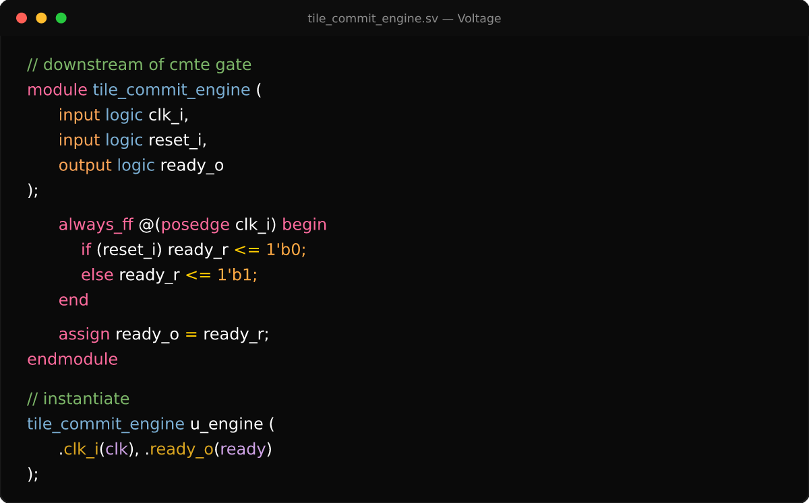

# Voltage

A high-contrast, vibrant dark theme with clear distinctions between declarations, types, parameters, struct/signal access and control flow.

<p align="center">
  
</p>

No dimming and no washed-out colors: a rich palette on a dark background, tuned for C/C++/CUDA, SystemVerilog, Tcl, Python, JSON, YAML, TOML and Markdown (editor and preview). It also adds syntax highlighting for nano config files (`.nanorc`).

## Preview

<p align="center">
  
</p>

## Setup

Press `Ctrl+Shift+P` → **Preferences: Color Theme** → **Voltage**.

For bracket-pair guide lines, add this to your `settings.json` (themes can set bracket colors, but can't turn on the guides):

```json
{
  "editor.guides.bracketPairs": true
}
```

## File icons

Voltage doesn't include file icons. If you use [Material Icon Theme](https://marketplace.visualstudio.com/items?itemName=PKief.material-icon-theme), these tints pair well:

```json
{
  "workbench.iconTheme": "material-icon-theme",
  "material-icon-theme.folders.color": "#F56600",
  "material-icon-theme.files.color": "#522DB0"
}
```

## More

The [project repository](https://github.com/VerdantLeaf/voltage-theme) has the [full palette](https://github.com/VerdantLeaf/voltage-theme/blob/main/docs/palette.md), plus Voltage for Vim, Neovim and nano.

## License

MIT
